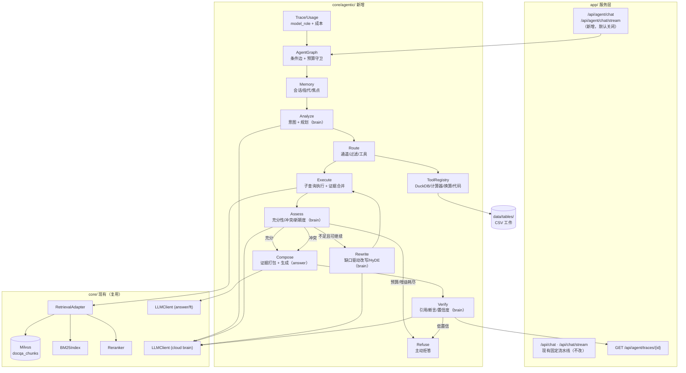
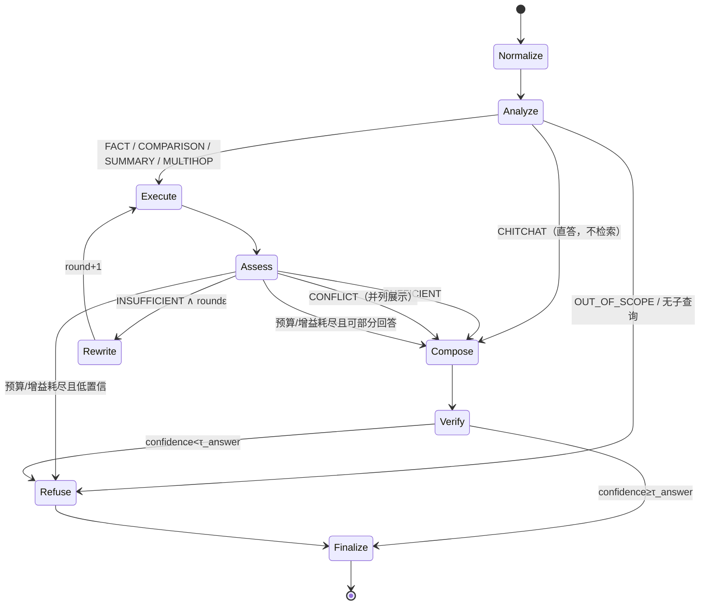

# Agentic RAG 增量架构设计（v2）

> 状态：**B0–B6 已实现，D2 全量消融已完成**（49 题 E0–E4 重跑、dev 阈值标定与联合标定、E4 trace 审计；全量 pytest 253 项全部通过，含 Milvus 端到端冒烟），B0–B5 能力保持零回归。
> 本版按五条硬约束收敛；基线数字只采用 `evaluation/results_rerank_ablation.json`。
> 设计原则：增量、可回退、可消融、可解释；不重做既有能力。

---

## 0. 设计结论

1. **不动固定流水线**：`RagPipeline._retrieve` 一行不改。Agent 通过新 `RetrievalAdapter` 组合现有 `search_dense` / `BM25Index.search` / `rrf_fuse` / `Reranker.rerank`，消融差异只来自编排。
2. **不动 Milvus**：不新增 collection / 索引 / 字段；块类型内存判定缓存；标量过滤只用现有 `source` / `page`；表格工件落 `data/tables/`。
3. **双模型分工**：意图/规划/评估/改写/校验固定走云端 brain；最终回答仍可切本机 Qwen3-1.7B。trace 中每个调用标注 `model_role`。
4. **自写状态机**：`core/agentic/graph.py`，零编排依赖，节点为纯函数，SSE 事件由节点回调产生。
5. **默认关闭**：`agent.enabled=false`；新能力只走 `/api/agent/chat` 与 `/api/agent/chat/stream`；`/api/chat` 零回归。
6. **闭环是真循环**：`retrieve → assess → rewrite → retrieve`，由条件边驱动，带轮数、token、时间、工具四类预算与新颖度早停。
7. **评测可追溯**：每个数字标注评估器来源；基线固定 MRR 0.776 → 0.843 → 0.939、Recall@5 1.000（小语料饱和）。

---

## 1. 仓库事实核对（设计的真实接入面）

### 1.1 已确认存在的接口

| 位置 | 真实签名 / 行为 | Agent 如何使用 |
|---|---|---|
| [pipeline.py L99](../core/pipeline.py#L99) | `_retrieve(question, top_k=None) -> tuple[list[dict], dict]`；内部 dense→BM25→RRF→可选 rerank | **不改**；仅作为行为基准做 parity 测试 |
| [pipeline.py L131](../core/pipeline.py#L131) | `_format_refs(contexts)` 静态方法 | 复用输出引用结构 |
| [pipeline.py L145](../core/pipeline.py#L145) | `_rewrite_query(history, question, llm)`；改写固定用 `self.llm`（cloud） | 记忆模块复用 `build_rewrite_messages`，策略一致 |
| [pipeline.py L157](../core/pipeline.py#L157) | `ask(question, top_k, llm, history)` | 固定流水线基线 E0，不改 |
| [pipeline.py L180](../core/pipeline.py#L180) | `prepare(question, top_k, rewrite_llm, history)` | 现有 SSE 检索阶段，不改 |
| [pipeline.py L22](../core/pipeline.py#L22) | `__init__(cfg, store=None, embedder=None, llm=None, reranker=None)` 支持依赖注入 | 单测/离线评测可注入 fake store |
| [vectorstore.py L66](../core/vectorstore.py#L66) | `search_dense(query_vec, top_k=20)`；L72 `filter=""` 硬编码 | 增加可选 `filter_expr`，默认空串 |
| [vectorstore.py L92](../core/vectorstore.py#L92) | `all_chunks(max_rows, wait_visible)` 返回 id/text/source/page/chunk_idx | 块类型缓存、表格工件扫描 |
| [bm25.py L21](../core/bm25.py#L21) | `build(rows)` 持有全量 `_meta` | 块类型无需额外拉取 |
| [bm25.py L26](../core/bm25.py#L26) | `search(query, top_k=20)` | 增加可选 `predicate`，默认 None |
| [fusion.py L12](../core/fusion.py#L12) | `rrf_fuse(result_lists, k=60, id_key="id")`，输出 `rrf_score/channels` | 原样复用 |
| [reranker.py L20](../core/reranker.py#L20) | `rerank(query, hits, top_n=5)`，写回 `rerank_score`；`enabled` 为假时直接截断 | 原样复用，遵循 `enabled` |
| [llm.py L21](../core/llm.py#L21) | `build_rewrite_messages(history, question)` | 指代消解第一层 |
| [llm.py L41](../core/llm.py#L41) | `build_messages(question, hits)` | 固定流水线提示词；Agent 另建 Compose 提示词 |
| [llm.py L50](../core/llm.py#L50) | `LLMClient`；L66 `chat`、L81 `chat_stream`、L122 `astream_chat` | **只新增方法**：usage 捕获、JSON、tools |
| [main.py L115](../app/main.py#L115) | `POST /api/chat` → `pipeline.ask(...)` | 不改 |
| [main.py L136](../app/main.py#L136) | `POST /api/chat/stream`；SSE `rewrite? → refs → delta* → done`，异常 `error` | 不改；Agent 流沿用同格式并新增 `trace` |
| [schemas.py L12](../app/schemas.py#L12) | `ChatRequest(question, top_k, llm, history)` | 新增 Agent 模型，旧模型不改 |
| [schemas.py L28](../app/schemas.py#L28) | `ChatResponse(answer, references, timings, total_ms, llm)` | 同上 |
| [config.yaml L46](../config/config.yaml#L46) | `retrieval`：dense/bm25/rrf_k/final_top_k；L52 `rerank.enabled=false` | 新增 `agent:` 段，旧段不改 |
| [results_rerank_ablation.json](../evaluation/results_rerank_ablation.json) | dense 1.000/0.776；hybrid 1.000/0.843；hybrid+rerank 1.000/0.939（49 题，116 块） | 唯一基线口径 |
| [loader.py L67](../core/loader.py#L67) | DOCX 表格被压成 `" | ".join(cells)` 的文本行 | 内存表格工件按管道行解析；不改 loader |
| [requirements.txt](../requirements.txt) | 无 `duckdb` / `langgraph` / `ragas` | 编排零新依赖；工具/评测依赖可选隔离 |

### 1.2 基线口径（唯一）

| 策略 | Recall@5 | MRR | 来源 |
|---|---|---|---|
| dense | 1.000（饱和） | 0.776 | `results_rerank_ablation.json` |
| hybrid（RRF） | 1.000（饱和） | 0.843 | 同上 |
| hybrid + rerank | 1.000（饱和） | 0.939 | 同上 |

约束：
- 所有文档、表格、README 只允许出现以上数字；**禁止出现 0.902 / 0.917 或任何转述数字**。
- 主对照实验固定 `retrieval.rerank.enabled=true`、`top_k=5`、同一语料；E0 显式开启 rerank，必须复现 1.000 / 0.939，否则消融脚本中止。0.843 仅为基线文件中的未重排参考行，不作为 E0 结果。小语料下 Recall@5 饱和，排序质量以 MRR 为准。
- 现有评估是 **LLM-as-Judge**（[eval_generation.py](../evaluation/eval_generation.py)），不是 RAGAS 库。新增 RAGAS 适配层并行输出；若只采用 RAGAS，必须先在旧系统上补跑同一测试集得到 RAGAS 基线，否则升级前后不可比。

---

## 2. 五条硬约束逐条落实

| # | 约束 | 落实方式 | 验收测试 |
|---|---|---|---|
| 1 | 零迁移 Milvus | 不调用任何建表/建索引 API；块类型由 `chunk_types.py` 规则判定并缓存在进程内；过滤表达式只允许 `source` / `page`；表格工件写 `data/tables/` | `test_agent_constraints.py`：fake store 记录调用，断言无 schema 变更；过滤字段白名单 |
| 2 | 复用检索链路 | `RetrievalAdapter` 直接调用现有四个组件；`_retrieve` 源码哈希冻结 | `test_retrieval_parity.py`：同一问题、默认通道下，Adapter 返回的 id 顺序与分数与 `_retrieve` 完全一致；`test_pipeline_untouched.py` 校验 `inspect.getsource(RagPipeline._retrieve)` 的 SHA256 |
| 3 | 双模型分工 | `AgentRuntime` 持有 `brain`（固定 `llms["cloud"]["client"]`）与 `answer`（请求所选）；所有调用记录 `model_role` | `test_agent_models.py`：断言规划/评估走 brain，最终生成走所选模型；trace 中角色齐全 |
| 4 | 自写状态机 | `graph.py` 自实现节点注册、条件边、预算守卫；不 import LangGraph；基础依赖不变 | `test_agent_graph.py`；`test_no_langgraph.py` 扫描源码/依赖 |
| 5 | 默认关闭 | 配置缺省 `enabled: false`；lifespan 仅在开启时构建 Agent；关闭时新端点返回 409，旧端点不触碰 Agent 对象 | `test_agent_disabled.py`：`app.state.agent is None`，`/api/chat` 正常，`/api/agent/*` 409 |

补充说明：`duckdb` 是工具层**可选依赖**，放 `requirements-agent.txt` 并延迟导入；未安装时表格工具返回 `tool_unavailable`，Agent 自动回退文本检索，基础服务与旧接口不受影响。编排层本身零新增依赖。

---

## 3. 增量架构总览



### 3.1 模块职责

| 模块 | 文件 | 输入 → 输出 | 是否调模型 |
|---|---|---|---|
| 状态定义 | `state.py` | 问题/会话 → `AgentState` | 否 |
| 图执行器 | `graph.py` | `AgentState` + 条件边 → 终态 | 否 |
| 记忆 | `memory.py` | history/session → 独立问题 + 焦点过滤 | brain（复用改写） |
| 分析 | `analyze.py` | 独立问题 → 意图 + 子查询计划 | brain，1 次 |
| 路由 | `route.py` | 意图/子查询/块类型 → 通道与工具 | 否 |
| 检索适配 | `retrieval.py` | 子查询 → 证据 + 耗时 | 否（嵌入模型除外） |
| 执行 | `execute.py` | 计划 → 去重证据池、新颖度 | 否 |
| 评估 | `assess.py` | 证据池 → 充分性/冲突/缺口 | brain，每轮 1 次 |
| 改写 | `rewrite.py` | 缺口 → 新子查询（含 HyDE） | brain，每轮 1 次 |
| 生成 | `compose.py` | 证据 → 带引用答案 | answer 模型 |
| 校验 | `verify.py` | 答案 + 证据 → 置信度/无据断言 | brain，可选 1 次 |
| 工具 | `tools/*` | 结构化请求 → 结果证据 | 工具执行 |
| 轨迹 | `trace.py` | 每节点事件 → JSON + SSE | 否 |

---

## 4. 状态机定义

### 4.1 状态与转移



| 起点 | 守卫 | 终点 |
|---|---|---|
| `Normalize` | 恒真 | `Analyze` |
| `Analyze` | `intent=CHITCHAT` | `Compose`（直答 prompt） |
| `Analyze` | `intent=OUT_OF_SCOPE` 或子查询为空 | `Refuse` |
| `Analyze` | 其余 | `Execute` |
| `Execute` | 恒真 | `Assess` |
| `Assess` | `decision=SUFFICIENT` | `Compose` |
| `Assess` | `decision=CONFLICT` | `Compose` |
| `Assess` | `INSUFFICIENT ∧ round < max_rounds ∧ budget.ok ∧ novelty > ε` | `Rewrite` |
| `Assess` | 上述任一不满足，且 `on_budget_exhausted=partial` | `Compose`（显式声明资料不足） |
| `Assess` | 上述任一不满足，且 `refuse` | `Refuse` |
| `Rewrite` | 恒真 | `Execute`（`round += 1`） |
| `Compose` | 恒真 | `Verify` |
| `Verify` | `confidence >= τ_answer` | `Finalize` |
| `Verify` | `confidence < τ_answer` | `Refuse` |
| `Refuse` | 恒真 | `Finalize` |

### 4.2 真循环伪代码

```python
state = normalize(state)                  # 指代消解 + 焦点源
state = analyze(state)                    # 意图 + 子查询（brain）
if state.intent in (CHITCHAT, OUT_OF_SCOPE):
    return finish_direct(state)

while True:
    state = execute(state)                # 每轮真实检索/工具调用
    state = assess(state)                 # brain 评估 + 规则特征

    if state.sufficiency.decision in (SUFFICIENT, CONFLICT):
        break
    if state.round >= state.budget.max_rounds:
        return exhausted(state, reason="max_rounds")
    if not state.budget.can_continue():
        return exhausted(state, reason="budget")
    if state.sufficiency.novelty <= state.budget.novelty_epsilon:
        return exhausted(state, reason="no_new_evidence")

    state = rewrite(state)                # 缺口驱动，round += 1

state = compose(state)                    # answer 模型
state = verify(state)                     # 引用校验（brain）
if state.confidence < verifier.tau:
    return refuse(state)
return finalize(state)
```

### 4.3 预算与终止

```yaml
agent:
  max_rounds: 3
  max_subqueries_per_round: 3
  budget:
    max_llm_calls: 8          # 含 brain 与 answer
    max_brain_calls: 6
    max_prompt_tokens: 12000
    max_completion_tokens: 4000
    max_wall_ms: 30000
    max_tool_calls: 3
    novelty_epsilon: 0.10
```

终止原因写入 `trace.stop_reason`：`sufficient / conflict / max_rounds / budget / no_new_evidence / low_confidence / out_of_scope`。评测报告统计各原因占比，防止"永远三轮"的假闭环。

### 4.4 `AgentState`

```python
class Intent(str, Enum):
    FACT = "fact"; COMPARISON = "comparison"; SUMMARY = "summary"
    MULTIHOP = "multihop"; CHITCHAT = "chitchat"; OUT_OF_SCOPE = "out_of_scope"

@dataclass
class SubQuery:
    text: str
    channels: tuple[str, ...] = ("dense", "bm25")
    source: str | None = None      # 只允许现有标量字段
    page: int | None = None
    use_hyde: bool = False
    purpose: str = ""

    @property
    def filter_expr(self) -> str:  # 由 source/page 白名单构造
        return build_filter_expr(self.source, self.page)

@dataclass
class Evidence:
    evidence_id: str               # E1..En
    chunk_id: int
    text: str
    source: str
    page: int
    chunk_idx: int
    chunk_type: str                # prose/table/code/enum/formula
    dense_score: float = 0.0
    bm25_score: float = 0.0
    rrf_score: float = 0.0
    rerank_score: float | None = None
    channels: list[str] = field(default_factory=list)
    round_found: int = 1
    sub_query: str = ""
    provenance: str = "retrieval"  # retrieval / tool / table

@dataclass
class Sufficiency:
    score: float
    claim_support: float
    coverage: float
    top_score: float
    diversity: float
    novelty: float
    missing_aspects: list[str]
    conflicts: list[dict]
    decision: str                  # SUFFICIENT / INSUFFICIENT / CONFLICT

@dataclass
class AgentState:
    trace_id: str
    session_id: str
    question: str
    standalone_question: str
    intent: Intent | None
    plan: list[SubQuery]
    round: int
    evidence: dict[int, Evidence]
    sufficiency: Sufficiency | None
    tool_results: list[dict]
    conflicts: list[dict]
    answer: str
    citations: list[dict]
    confidence: float
    status: str                    # answered / refused / partial / error
    budget: Budget
    usage: Usage                   # brain/answer 分开累计
    trace: list[dict]
```

---

## 5. 功能模块设计

### 5.1 查询规划

`Analyze` 一次 brain 调用同时输出意图与计划，减少调用次数：

```json
{
  "intent": "multihop",
  "sub_queries": [
    {"text": "bge-m3 最大输入长度", "channels": ["dense", "bm25"], "purpose": "第一跳"},
    {"text": "bge-reranker-v2-m3 输入长度限制", "channels": ["dense", "bm25"], "purpose": "第二跳"}
  ],
  "needs_table": false,
  "needs_calculation": false
}
```

| 意图 | 规划 | 通道 | 轮次上限 |
|---|---|---|---|
| FACT | 单查询，疑问词归一 | dense + BM25 | 2 |
| COMPARISON | 按实体拆 2 个子查询 + 1 个维度查询 | dense + BM25 | 3 |
| SUMMARY | 识别"这份/该文档"→ `source` 过滤；最终证据数提升 | dense + BM25 + filter | 1 |
| MULTIHOP | 顺序分解，第二跳可用第一跳答案构造 | dense + BM25 | 3 |
| CHITCHAT | 不检索 | 无 | 0 |
| OUT_OF_SCOPE | 不检索 | 无 | 0 |

- **HyDE**：仅第 2 轮起启用；假设答案只用于 dense，BM25 仍用原关键词；开关 `agent.hyde.enabled`。注意：D2 消融的 E1–E4 均未启用 HyDE（E1 关闭后后续变体只增量覆盖其他键），消融数字不含 HyDE 贡献。
- **失败降级**：brain JSON 解析失败重试 1 次；仍失败则规则分类 + 原问题单查询，不中断服务。

### 5.2 智能路由（不新增 Milvus 字段）

| 条件 | 路由 |
|---|---|
| 默认 | dense + BM25 → RRF → rerank |
| 专有名词/编号/公式/代码 | BM25 优先，dense 兜底 |
| 含 source/page 约束 | Milvus `filter`（仅现有字段） |
| 问题含聚合/比较/极值，且命中 table 块 | DuckDB 查 `data/tables/`，文本检索补充 |
| 需要算术/单位换算 | calculator / unit_convert |
| 两轮无新证据 | 直接停，不再消耗预算 |
| CHITCHAT / OUT_OF_SCOPE | 不检索 |

**块类型规则**（确定性，无模型）：

```
table   : 连续 ≥2 行含 "|" 且列数一致；或含制表符对齐
code    : ``` 围栏，或符号密度超阈值
enum    : ≥3 行以 - / 1. / （1） 开头
formula : 含 =、∑、∫、% 且数字密度高
prose   : 其余
```

块类型来源：`BM25Index._meta` 已持有全量 chunk，首次使用时计算并缓存 `dict[chunk_id, type]`；不落库、不改 schema。

**表格工件**：
- 扫描 chunk 文本中的管道行（DOCX 表格已被 loader 压成 `" | "` 行；Markdown 表格天然保留）；
- 列数一致且 ≥2 行才建表；首行作表头；
- 写 `data/tables/{source_hash}_{chunk_idx}.csv`，登记 `registry.json`；
- 预构建脚本 `scripts/build_table_registry.py`；懒加载兜底。
- 局限：PDF 复杂表格不保证还原，检测失败时回退文本检索并在 trace 标记 `table_extract=skipped`。

### 5.3 自反思闭环（核心）

**充分性公式**（可解释、可复现）：

```
score = 0.45 * claim_support    # brain 逐子问题判定 0/0.5/1
      + 0.25 * coverage         # 子查询实体/术语覆盖率（规则）
      + 0.20 * top_score        # rerank 分归一化；无 rerank 用 RRF 分位
      + 0.10 * diversity        # 不同来源数 / 期望来源数，封顶 1
```

- `score ≥ τ_high` → `SUFFICIENT`
- `score < τ_low` 且存在冲突 → `CONFLICT`
- 其余 → `INSUFFICIENT`，预算允许则 `Rewrite`
- `top_score` 归一化：API rerank 分已在 0–1；本地 CrossEncoder 用 sigmoid；无 rerank 时用 RRF 排名分位。
- brain 失败时只用规则特征（coverage/top_score/diversity）并标记 `degraded=true`，不影响循环继续。

**缺口驱动改写**（四种手段，不是简单同义替换）：
1. 依据 `missing_aspects` 生成新子查询；
2. 用第一跳答案构造第二跳查询；
3. 同义词/英文术语/缩写扩展；
4. HyDE 或收窄 `source/page`。

**新颖度**：`novelty = 本轮新增 chunk 数 / 本轮证据总数`；`≤ ε` 即检索饱和，停止并记录 `no_new_evidence`。

### 5.4 工具层（function calling）

| 工具 | 能力 | 安全约束 |
|---|---|---|
| `duckdb_query` | 对白名单 table_id 执行只读 SQL，精确聚合/比较/极值 | 仅 SELECT/WITH；拒绝 ATTACH/COPY/INSTALL/LOAD/PRAGMA/read_*；行数上限 200；3s 超时；仅内存视图 |
| `calculator` | 算术表达式 | AST 白名单；禁止属性/下标/导入/调用非白名单函数 |
| `unit_convert` | 数值 + 单位换算 | 预置单位表，未知单位报错 |
| `code_exec` | Python 片段 | 子进程 + 3s 超时 + 清空环境变量；**默认关闭**；Windows 无强沙箱，文档明确标注仅本地演示 |

调用链：`LLMClient.chat_with_tools(messages, tools)` → 模型返回 `tool_calls` → `ToolRegistry.execute` → 结果作为 `Evidence(provenance=tool)` 注入。模型不支持 tools 时，使用 `Analyze` 输出的 `needs_table/needs_calculation` 做确定性调用，最多 3 次。

### 5.5 对话记忆

- **会话内**：`SessionStore`（`session_id -> turns/focus_source/focus_page/last_evidence_ids`），TTL 2h，最多 20 轮，内存 + 可选 JSON 持久化。
- 指代消解：复用 `build_rewrite_messages`；出现"它/该文档/上一份/第 X 页"时，把焦点转换成 `source/page` 过滤提示。
- 无 `session_id` 时退化为现有请求级 `history` 行为，与当前系统一致。
- **长期偏好（可选，默认关闭）**：`data/user_profile.json`，仅注入 Compose 的 system prompt，不参与检索决策，避免偏好污染证据。

### 5.6 可信输出

- 证据编号 `E1..En`；`references` 返回 `evidence_id/source/page/chunk_idx/snippet/score/channels`。
- Compose 要求：每个事实句至少一个有效引用；冲突证据并列（"说法 A（来源 1）／说法 B（来源 2）"）；无证据句不得出现。
- Verify：
  1. 标记有效性：非法 `[Ex]` 计入 `invalid_citation`；
  2. 引用覆盖率：`带有效引用的实义句 / 实义句总数`，低于 `min_coverage` 降级；
  3. 断言支持度（可选）：brain 批量校验，输出 `unsupported_claims`；失败不阻塞。
- 置信度：

```
confidence = 0.4 * sufficiency.score
           + 0.3 * verified_support
           + 0.2 * citation_coverage
           + 0.1 * (1 - conflict_penalty)
```

- `confidence < τ_answer` → 拒答或部分回答（`on_budget_exhausted`）。
- 阈值由 `evaluation/calibrate_thresholds.py` 在 **dev split** 上标定，目标拒答 F1 最大且可答题误拒率 ≤ 5%；结果写 `data/calibration.json`，配置引用文件。
- 当导出数据包含 `raw_confidence` 与 `coverage` 时，脚本对 `(τ, min_coverage)` 做联合网格搜索，避免单一阈值与覆盖率钳位相互干扰；旧格式（仅 confidence）自动退化为 τ 单参数标定。

### 5.7 可观测性

每个节点产生统一事件：

```json
{"type":"trace","trace_id":"tr-...","stage":"assess","round":2,"status":"ok",
 "latency_ms":412,"model_role":"brain",
 "payload":{"score":0.58,"decision":"insufficient","missing_aspects":["第二跳"],
 "novelty":0.2,"stop_reason":null},"ts":1760000000.0}
```

- `Usage` 分账：`brain_llm_calls / brain_prompt_tokens / brain_completion_tokens / brain_latency_ms`，`answer_*` 同结构；另记 `tool_calls / wall_ms / est_cost`。
- usage 捕获：非流式读 `usage`；流式请求 `stream_options.include_usage`，服务端不支持时按字符估算并标 `estimated=true`。
- trace 落盘 `data/traces/{trace_id}.json`；`GET /api/agent/traces` 列表回放，`GET /api/agent/traces/{trace_id}` 取单条。
- SSE 事件序列：`session → trace(normalize/analyze/round/retrieve/assess/rewrite/tool) → delta* → trace(verify) → refs → done`；`ask_stream` 确保 `delta` 先于最终 `refs`，旧客户端忽略未知事件。

---

## 6. 接入点与改动范围

### 6.1 改动矩阵

| 文件 | 改动 | 兼容策略 |
|---|---|---|
| `core/pipeline.py` | **零改动**（`_retrieve/ask/prepare` 全部保留） | 源码哈希测试 |
| `core/vectorstore.py` | `search_dense(..., filter_expr: str = "")` | 默认空串，行为不变 |
| `core/bm25.py` | `search(..., predicate=None)`，排序前过滤候选 | 默认 None，行为不变 |
| `core/llm.py` | 新增 `chat_json` / `chat_with_tools` / usage 捕获；旧方法签名不变 | 纯增量 |
| `core/loader.py` | 不改 | 表格从 chunk 文本解析 |
| `app/main.py` | `include_router(agent_router)`；lifespan 条件构建 Agent | 旧路由不动 |
| `app/schemas.py` | 新增 Agent 请求/响应/引用/trace 模型 | 旧模型不动 |
| `app/config.py` | 不改（YAML 的 `agent:` 段自动进入 cfg） | 缺省关闭 |
| `config/config.yaml` | 新增 `agent:` 段 | 旧键不动 |
| `webui/streamlit_app.py` | Agent 开关、trace 面板、引用高亮 | 旧事件解析不变 |
| `requirements.txt` | 不改 | 基础安装不变 |
| `requirements-agent.txt` | 新增 `duckdb`（可选） | 延迟导入，缺失降级 |
| `evaluation/*` | 新增指标/数据集/标定/消融脚本 | 旧脚本保留 |
| `tests/*` | 新增约束/图/循环/工具/引用/API 测试 | 旧 3 个测试全通过 |

### 6.2 RetrievalAdapter（复用而非改写）

```python
class RetrievalAdapter:
    def __init__(self, store, bm25, embedder, reranker, *,
                 rrf_k: int = 60, dense_top_k: int = 20, bm25_top_k: int = 20):
        ...

    @classmethod
    def from_pipeline(cls, pipeline: RagPipeline) -> "RetrievalAdapter":
        return cls(pipeline.store, pipeline.bm25, pipeline.embedder,
                   pipeline.reranker, rrf_k=pipeline.cfg["retrieval"]["rrf_k"])

    def search(self, sub_query: SubQuery, top_k: int = 5) -> tuple[list[dict], dict]:
        # HyDE（可选）→ 仅 dense
        # store.search_dense(vec, top_k=dense_top_k, filter_expr=sub_query.filter_expr)
        # bm25.search(text, top_k=bm25_top_k, predicate=...)
        # rrf_fuse([dense_hits, bm25_hits], k=rrf_k)
        # reranker.enabled ? reranker.rerank(text, fused, top_n=top_k) : fused[:top_k]
```

- 默认参数、默认通道、无过滤、无 HyDE 时，输出必须与 `RagPipeline._retrieve` 完全一致（parity 测试）。
- `filter_expr` 构造器只接受 `source` / `page`，白名单校验，拒绝任意表达式注入。
- 离线评测（2Wiki）可注入内存 store，不碰生产 Milvus。

### 6.3 新增文件树

```
core/agentic/
├── __init__.py
├── state.py
├── graph.py
├── runtime.py
├── retrieval.py
├── memory.py
├── analyze.py
├── route.py
├── execute.py
├── assess.py
├── rewrite.py
├── compose.py
├── verify.py
├── chunk_types.py
├── tables.py
├── trace.py
└── tools/
    ├── __init__.py
    ├── duckdb_tool.py
    ├── calculator.py
    ├── unit_convert.py
    └── code_exec.py

app/agent_api.py
evaluation/metrics.py            # EM/F1、拒答、引用/幻觉、检索、RAGAS 适配
evaluation/build_qa_zh.py        # 300 题中文集生成
evaluation/eval_multihop.py      # 2Wiki/HotpotQA 内存 BM25 评测（不建 Milvus collection）
evaluation/ablation_agentic.py   # E0–E4 消融（基线校验 + 结果 JSON）
evaluation/calibrate_thresholds.py
evaluation/export_dev_confidence.py
evaluation/dev_set.jsonl
scripts/build_table_registry.py
tests/test_agent_constraints.py
tests/test_retrieval_parity.py
tests/test_agent_graph.py
tests/test_agent_loop.py
tests/test_agent_tools.py
tests/test_agent_memory.py
tests/test_agent_citations.py
tests/test_agent_api.py
tests/test_agent_disabled.py
tests/test_pipeline_untouched.py
```

### 6.4 API

**请求**：

```json
POST /api/agent/chat
{
  "question": "bge-m3 和 bge-reranker 的输入长度有什么区别？",
  "session_id": "sess-123",
  "llm": "ft",
  "top_k": 5,
  "history": [],
  "include_trace": false
}
```

**响应**：

```json
{
  "answer": "……[E1]……[E2]……",
  "references": [{"evidence_id":"E1","source":"向量嵌入模型.md","page":1,
                  "chunk_idx":3,"snippet":"……","score":0.93,
                  "channels":["dense","bm25"]}],
  "citations": [{"sentence":"……","evidence_ids":["E1"]}],
  "conflicts": [],
  "confidence": 0.78,
  "refused": false,
  "refusal_reason": null,
  "session_id": "sess-123",
  "trace_id": "tr-20261120-xxxx",
  "metrics": {
    "rounds": 2, "sub_queries": 3, "tool_calls": 0,
    "brain_llm_calls": 4, "brain_latency_ms": 2100,
    "answer_llm_calls": 1, "answer_latency_ms": 1800,
    "prompt_tokens": 4210, "completion_tokens": 612,
    "cost_cny": 0.0031, "latency_ms": 6840, "stop_reason": "sufficient"
  },
  "llm": "ft"
}
```

- `GET /api/agent/traces/{trace_id}` 返回完整轨迹。
- 关闭时 `/api/agent/*` 返回 409 `agent_disabled`。
- 旧 `/api/chat` 不读取 `session_id`，不构建 Agent，不受影响。

### 6.5 配置

```yaml
agent:
  enabled: false
  brain_llm: "cloud"            # 固定云端档案 id
  max_rounds: 3
  max_subqueries_per_round: 3
  top_k_per_subquery: 5
  max_final_evidence: 8
  on_budget_exhausted: "partial" # partial | refuse

  budget:
    max_llm_calls: 8
    max_brain_calls: 6
    max_prompt_tokens: 12000
    max_completion_tokens: 4000
    max_wall_ms: 30000
    max_tool_calls: 3
    novelty_epsilon: 0.10

  sufficiency:
    tau_low: 0.45
    tau_high: 0.65
    weights: {claim_support: 0.45, coverage: 0.25, top_score: 0.20, diversity: 0.10}

  hyde: {enabled: true, start_round: 2}
  citations: {min_coverage: 0.60, verify_claims: true, tau_answer_confidence: 0.55}

  tools:
    enabled: true
    duckdb: {enabled: true, max_rows: 200, timeout_ms: 3000}
    calculator: {enabled: true}
    unit_convert: {enabled: true}
    code_exec: {enabled: false, timeout_ms: 3000}

  memory: {session_ttl_s: 7200, max_turns: 20}
  trace: {enabled: true, dir: "data/traces"}
  cost: {prompt_per_1k: 0.0, completion_per_1k: 0.0}
```

---

## 7. `/api/chat` 零回归验证方案

| 编号 | 验证 | 方法 | 通过标准 |
|---|---|---|---|
| R1 | 旧单测 | `pytest tests/test_fusion.py tests/test_splitter.py tests/test_pipeline_smoke.py -q` | 全绿 |
| R2 | `_retrieve` 未改 | `inspect.getsource(RagPipeline._retrieve)` SHA256 与 B0 前快照比对 | 哈希一致 |
| R3 | `/api/chat` 契约 | fake pipeline + FakeLLM，固定问题/历史，比对响应键、引用字段、`timings` 键 | 结构与值一致 |
| R4 | `/api/chat/stream` 事件序 | 同一 fake，解析 SSE | 事件序 `refs → delta* → done`，字段一致 |
| R5 | 检索等价 | `RetrievalAdapter.from_pipeline(p).search(q, 5)` vs `p._retrieve(q, 5)` | id 顺序、`rrf_score`、`rerank_score` 完全一致 |
| R6 | 关闭隔离 | `agent.enabled=false` 启动 | `app.state.agent is None`；`/api/chat` 200；`/api/agent/chat` 409 |
| R7 | 评估不退化 | `evaluation/eval_retrieval.py`（rerank=true） | Recall@5 1.000（饱和）、MRR 0.939 |

R2 的哈希在 B0 动工前由脚本生成并提交，作为"不改一行"的硬证据。R5 使用现有 mock embedding + 临时 Milvus Lite/fake store，避免网络依赖。

---

## 8. 评测方案

### 8.1 指标与评估器（每个数字必须带来源）

| 指标 | 评估器 / 来源 | 说明 |
|---|---|---|
| Recall@5 / MRR | `evaluation/eval_retrieval.py` | 沿用现有口径；Agent 另报多轮并集 Recall |
| LLM-as-Judge 忠实度/相关性 | `evaluation/eval_generation.py` | 保留现有 1–5 分口径，纵向可比 |
| EM / F1 | `evaluation/metrics.py`（新增） | 英文词级、中文字符级；SQuAD 归一化 |
| RAGAS-F/AR/CP/CR | `evaluation/metrics.py` 的 `ragas_scores`（可选依赖） | 若只报 RAGAS，须先补跑旧系统基线；未安装则 `available=false` |
| 拒答 P/R/F1 | `evaluation/metrics.py` | 不可答题召回；全部拒答中的正确率 |
| 幻觉率 | `verify.py` 的 `unsupported_claims` + `eval_generation.py` | 无据断言率；另报“不可答被回答率”。E4 审计需剔除拒答/无资料说明句，否则无引用句会被误计为幻觉 |
| 平均检索轮次 | trace | `execute` 次数与分布 |
| Token / 成本 | trace usage | brain 与 answer 分账；单价可配 |
| 端到端延迟 | trace | P50/P95、首字、brain 累计延迟 |

### 8.2 数据集

1. **主评估集 / 回归集**：`evaluation/eval_set.json`，49 题（44 可答 + 5 拒答），可答题带人工 `answer` 与 gold（source/page/must_contain），SHA256 冻结；升级前后都跑。
2. **dev 标定集**：`evaluation/dev_set.jsonl`，40 题（30 可答 + 10 拒答），与 49 题零重叠、问题无重复，仅用于阈值标定，产物 `data/calibration.json`。
3. **自建中文 300 题**：`evaluation/qa_zh_300.jsonl`（300 道唯一问题、24 道拒答、覆盖 20 篇文档），由 `build_qa_zh.py` 离线生成。默认 `template` 模式从块内抽取原文短语，检索偏易，**仅用于规模回归、稳定性与阈值标定，不替代 49 题人工 gold 评估集**；`--mode llm` 可让 brain 起草，`must_contain` 必须逐字出现在原文。
4. **2Wiki / HotpotQA**：`eval_multihop.py` 直接读取整理后的 JSON/JSONL，用内存 BM25 排序，**不依赖 Milvus**；输出 Recall@k / MRR / nDCG@k，带 `prediction` 时同时计算 EM/F1。

### 8.3 消融矩阵

| 编号 | 系统 | 规划/路由 | 反思闭环 | 工具 | 记忆+引用 |
|---|---|---|---|---|---|
| E0 | 固定流水线 | ✗ | ✗ | ✗ | 仅现有改写 |
| E1 | + 规划/路由（单轮） | ✓ | ✗ | ✗ | ✗ |
| E2 | + 反思闭环 | ✓ | ✓ | ✗ | ✗ |
| E3 | + 工具层 | ✓ | ✓ | ✓ | ✗ |
| E4 | Agentic 全量 | ✓ | ✓ | ✓ | ✓ |

**D2 全量结果**（2026-11-23 重跑；49 题 = 44 可答 + 5 拒答；节点重试与空答案拒答口径生效，τ=0.30 / min_coverage=0.0；E0 基线校验通过；每个指标带 `evaluator`）：

| 系统 | Recall@5¹ | MRR¹ | nDCG@5¹ | EM² | F1² | 拒答 P/R/F1² | 引用覆盖³ | 幻觉率³ | 平均延迟⁴ |
|---|---|---|---|---|---|---|---|---|---|
| E0 固定流水线 | 1.000 | 0.939 | 0.955 | 0.000 | 0.437 | 0.333 / 1.000 / 0.500 | —（未生成引用） | — | 6.3s |
| E1 + 规划/路由 | 0.955 | 0.905 | 0.918 | 0.000 | 0.389 | 0.500 / 0.200 / 0.286 | — | — | 20.4s |
| E2 + 自反思 | 0.955 | 0.905 | 0.918 | 0.000 | 0.389 | 0.333 / 0.200 / 0.250 | — | — | 23.9s |
| E3 + 工具层 | 0.955 | 0.905 | 0.918 | 0.000 | 0.397 | 0.333 / 0.200 / 0.250 | — | — | 22.9s |
| E4 + 可信输出 | 0.932 | 0.867 | 0.884 | 0.023 | 0.478 | 0.500 / 0.600 / 0.545 | 0.760 | 0.197† | 34.2s |

> ¹ programmatic（`eval_retrieval.py` 同口径）；² `metrics.py`（programmatic）；³ `verify.py` 逐句校验（E4 启用；E0–E3 未生成引用，记 —）；⁴ trace 运行时计量。RAGAS 未安装、未运行，不以外源补数。E0 固定启用 rerank，0.843 仅为基线文件中的未重排参考行，不计入主表。小语料下 Recall@5 饱和至 1.000，排序增益以 MRR 衡量。
>
> 负结果与边界：① E0 的 MRR 0.939 已是本语料上限，Agent 用规划子查询替换原问题后检索反而变差（E1–E3 0.905、E4 0.867），自反思在小语料上无生成增益（E1 F1 0.389 → E2 0.389）；② E2/E3 各 1 次、E4 2 次 `node_error`（重试后仍有瞬时故障），E4 另有 3 次 `budget` 停止；③ † 幻觉率 0.197 为校验器上界——人工核对 E4 本轮 45 条含 verify 的 trace 后，13 条 unsupported 中 12 条为拒答/无资料说明句、1 条为无引用引导句，无事实性编造；另有 9/63 条非法引用（0.143）；④ 联合标定启用后，E4 拒答召回 0.600（漏拒 2 道）、误拒 3 道，阈值迁移仍有精度/召回取舍（见 8.4）。

另出分题型表（事实/对比/汇总/多跳/不可答）与 2Wiki 表（EM/F1/平均轮次）。显著性用 paired bootstrap（1000 次，95% CI）。

### 8.4 阈值标定

- 只用 dev split：`evaluation/dev_set.jsonl` 40 题（30 可答 + 10 拒答），与 49 题 test 集零重叠、问题无重复。
- 目标：拒答 F1 最大，且可答题误拒率 ≤ 5%。
- 产物 `data/calibration.json`：τ_answer_confidence=0.30、min_coverage=0.0，dev 上拒答 F1 1.00、误拒率 0；test 不参与标定。
- 重跑验证：启用联合标定后，E4 `low_confidence` 10→2、可答题误拒 7→3，但拒答召回 1.000→0.600（漏拒 2 道）；dev 最优阈值迁移到 test 后仍需在拒答 precision 与 recall 间取舍。
- 限制：E4 共 63 条引用中 9 条非法（0.143）、覆盖率为 0.760；后续应按 claim 重要性计算覆盖，或对拒答/无资料说明句豁免引用要求。

---

## 9. 分批交付

| 批次 | 交付 | 运行/测试 | 验收 |
|---|---|---|---|
| **B0** | `state.py`、`graph.py`、`trace.py`、配置段、`runtime.py` 骨架、`agent_api.py`、R2/R5/R6 基线测试 | `pytest tests/test_agent_graph.py tests/test_agent_constraints.py tests/test_agent_disabled.py` | 状态机跑通直答；旧测试全绿；哈希快照生成 |
| **B1** | `analyze.py`、`route.py`、`retrieval.py`、`chunk_types.py`、过滤 | `pytest tests/test_retrieval_parity.py tests/test_agent_loop.py -k single` | 五类意图分支正确；单轮可答；parity 通过 |
| **B2** | `execute.py`、`assess.py`、`rewrite.py`、预算/新颖度 | `pytest tests/test_agent_loop.py` | "首轮不足→二轮补全"用例通过；停止原因正确 |
| **B3** | `tables.py`、4 工具、`build_table_registry.py` | `pytest tests/test_agent_tools.py` | 聚合正确；危险 SQL 被拒；无 duckdb 时降级 |
| **B4** | `memory.py`、`compose.py`、`verify.py`、标定脚本 | `pytest tests/test_agent_memory.py tests/test_agent_citations.py` | 指代消解、非法引用检出、低置信拒答 |
| **B5** | trace 落盘/查询、SSE、Streamlit | `pytest tests/test_agent_api.py` + 手工 SSE | 可回放轨迹；brain/answer 分账 |
| **B6** | `evaluation/metrics.py`、`build_qa_zh.py`、`qa_zh_300.jsonl`、`eval_multihop.py`、`ablation_agentic.py`、README | `pytest tests/test_eval_metrics.py tests/test_eval_datasets.py tests/test_eval_ablation.py` | 300 题唯一且覆盖 20 文档；E0–E4 表逐指标标注评估器；检索基线只读 `results_rerank_ablation.json` |

每批结束执行：`pytest -v` + `python evaluation/eval_retrieval.py`，确认 Recall@5 1.000（饱和）/ MRR 0.939 不退化。

---

## 10. 风险与边界

| 风险 | 缓解 |
|---|---|
| Agent 调用次数上升 | Analyze 合并分类与规划；按意图限轮次；预算硬门；简单题快速路径 |
| 充分性评估抖动 | dev 标定；规则特征兜底；新颖度早停；记录 `degraded` |
| 微调模型不支持 function calling | 工具仅由 brain 发起；确定性路由兜底；answer 模型不参与工具决策 |
| PDF 表格失真 | 只对管道行/结构化工件建表；失败回退文本并标记 |
| 2Wiki 英文与中文系统分布差异 | 单列报表；BGE-M3 多语言；可选中文翻译子集 |
| RAGAS 依赖重/版本敏感 | 独立 `requirements-agent.txt`（可选）；未安装则 `available=false`，不用其他分数替代 |
| 代码执行安全 | 默认关闭；子进程超时；文档标注仅本地演示 |

**不做**：多 Agent 角色互聊、Milvus schema 迁移、重算向量、换嵌入/重排模型、在线学习、分布式调度。

---

## 11. 设计确认项

五条硬约束与评测口径已按你的指令锁定，不再作为可选项。开工前只需确认本设计本身：

1. 状态机、接入点、API 形态是否认可；
2. 300 题采用"LLM 起草 + 人工校验 + dev/test 切分"是否认可；
3. 表格工件由现有 chunk 的管道行解析（不新增 CSV/XLSX 入库）是否满足工具层演示需要；
4. `duckdb` 作为 `requirements-agent.txt` 可选依赖、缺失时降级，是否接受。

回复"开始 B0"即按本设计进入编码；若某条要调整，指出条目即可。
